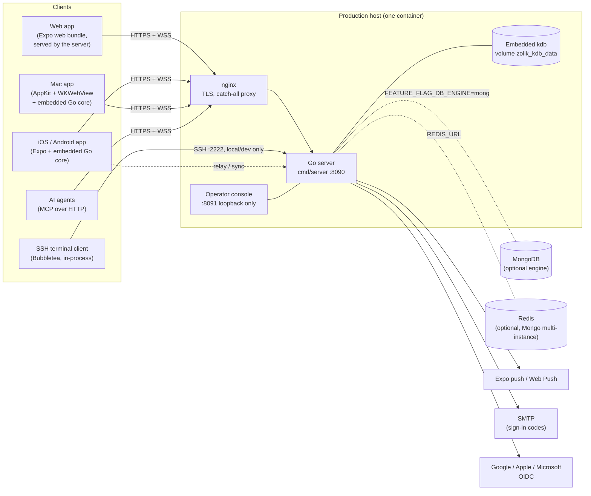

# Architecture

Zolik is the code name of the card-game platform published as **Jokerless**
([jokerless.com](https://jokerless.com)). This directory describes how it is
built as of `main` in November 2026 (VERSION 1.19.0). Everything here was
checked against the code; where an older document disagrees, the code wins
and the disagreement is listed in [Known gaps](#known-gaps-and-stale-documents).

| Document | What it covers |
|---|---|
| [server.md](server.md) | Process structure, HTTP/WebSocket flow, match lifecycle, concurrency and locking, persistence (kdb vs Mongo), scaling |
| [game-modules.md](game-modules.md) | The `module.GameModule` contract, written rules and rule ids, options and variations, hidden information, scoring, the seventeen games |
| [bots-and-ai.md](bots-and-ai.md) | Heuristic bots, trained models (`internal/learn`, `ml/`), the compute governor, MCP agent seats and the game MCP server |
| [clients.md](clients.md) | React Native/Expo (web, iOS, Android), the Mac app, the SSH terminal client, the embedded Go core, offline and hybrid tables, i18n, skins, accessibility |
| [identity-and-security.md](identity-and-security.md) | Accounts and guests, tokens and their lifetimes, the guest key, seat links, admin console, rate limits, hardening switches |
| [deployment-and-operations.md](deployment-and-operations.md) | The Docker image, the production host and domains, releases, observability, `/debug/memory` |
| [decisions.md](decisions.md) | Key design decisions as short ADRs |

Developer how-tos (running the stack, tests, adding a game or a message key)
are in [../developer/README.md](../developer/README.md).

## The idea in one paragraph

The server does not know which card game it is running, and neither do the
clients. Each game is a **module** that implements one Go interface
([`server/internal/module/protocol.go`](../../server/internal/module/protocol.go)):
deal a match, apply an action, describe the board as *zones* a given viewer may
see, and list the *offers* that viewer may take (enabled or not, with a reason
code). One runtime ([`server/internal/match`](../../server/internal/match))
persists, routes, broadcasts and drives bots for all of them; one client
screen renders all of them from the offers and the view. The rule the design
enforces, stated in the root [README](../../README.md):

> Every rule-derived fact is computed once, on the server, inside the module —
> and shipped. A client that has to *derive* a rule is a bug.

## System context

Notes on the diagram:

- **Production runs kdb**, an embedded database linked into the binary, in a
  single container with no Mongo and no Redis
  ([`deploy/compose/zolik.yml`](../../deploy/compose/zolik.yml)). The Mongo
  engine and the Redis fan-out still exist behind
  `FEATURE_FLAG_DB_ENGINE=mongo` and `REDIS_URL`, and the code defaults to
  Mongo when the flag is unset ([`internal/app/config.go`](../../server/internal/app/config.go)).
- The **web client is compiled into the server binary**
  ([`internal/webui`](../../server/internal/webui)) and served for every path
  the API does not claim.
- The **terminal client** is a Go module ([`client-tui`](../../client-tui))
  linked into `cmd/server` and exposed over SSH. Production turns it off.
- **Phones and the Mac host offline tables themselves** with the same runtime
  ([`server/mobile/zolikcore`](../../server/mobile/zolikcore)); the cloud
  server can relay remote guests to such a table
  ([`internal/relay`](../../server/internal/relay)) and replicate data with it
  ([`internal/sync`](../../server/internal/sync)).
- There are **two MCP surfaces**: `POST /mcp` on the live server seats AI
  agents at real tables ([`internal/mcp`](../../server/internal/mcp)), and the
  stand-alone `game-mcp` command plays offline tables on the engine for
  analysis and coaching ([`internal/gamemcp`](../../server/internal/gamemcp)).

## Repository map

| Path | Contents |
|---|---|
| [`server/`](../../server) | Go module `zolik/server`: the runtime, every game module, auth, storage, tools under `cmd/` |
| [`server/internal/module`](../../server/internal/module) | The module contract, shared helpers (rules index, skills, intermission, conformance driver) |
| [`server/internal/match`](../../server/internal/match) | The game-agnostic runtime |
| `server/internal/<game>` | One package per game (see [game-modules.md](game-modules.md#the-games)) |
| [`server/mobile/zolikcore`](../../server/mobile/zolikcore) | The server as embedded in the phone and Mac apps (gomobile) |
| [`client-react-native/`](../../client-react-native) | Expo app: web, iOS, Android |
| [`client-macos/`](../../client-macos) | Native Mac shell around the web client |
| [`client-tui/`](../../client-tui) | SSH terminal client (Go module `zolik/client-tui`) |
| [`e2e/`](../../e2e) | Playwright suites and the longevity soak |
| [`ml/`](../../ml) | Python trainer for the learned bots |
| [`deploy/`](../../deploy), [`scripts/`](../../scripts) | Production compose and nginx, deploy and dev-stack scripts |
| `../kdb` (sibling checkout) | The kdb database, wired in by `replace github.com/limidus/kdb/go => ../../kdb/go` in [`server/go.mod`](../../server/go.mod) |

## Known gaps and stale documents

These were found while writing this set. They are listed here so they are not
lost; none has been fixed in this change.

**Stale documents**

- [`docs/architecture.md`](../architecture.md) is the original 2026 review of
  the Žolíky-only server. Its diagrams and package table name
  `internal/game`, `/games/*` routes and a `Manager.RunAIIfNeeded` loop that no
  longer exist (the runtime is `internal/match`, routes are `/matches/*`).
  Treat it as history; this directory replaces it as a description.
- [`server/README.md`](../../server/README.md) is titled "Žolíky backend (v1
  scaffold)" and says multi-instance deployments may reconnect to any node
  because "state is always loaded from MongoDB". Match state now lives in
  process memory and is rebuilt from snapshots plus moves
  ([`match/live.go`](../../server/internal/match/live.go)); see
  [server.md § Scaling](server.md#scaling).
- The root [`README.md`](../../README.md) speaks of "two clients" (there are
  three plus the Mac shell) and says play.limidus.com in the licence section
  while jokerless.com is canonical.
- [`client-react-native/README.md`](../../client-react-native/README.md) says
  the Expo web dev server runs on port 8091 (that is the admin console's port;
  the dev stack uses 8114), lists "Create / join lobby ... (4+ players)" and
  `useGameSocket.ts`/`game_state`; the hook is
  [`useMatchSocket.ts`](../../client-react-native/src/hooks/useMatchSocket.ts)
  and the frame type is `match_state`.
- [`client-tui/README.md`](../../client-tui/README.md) and the module
  comments describe a "Žolíky" client; the TUI plays every module through the
  generic offer protocol.
- [`server/README.md`](../../server/README.md) § Bots says the console switches
  whether "the Hard bot seats" play the model; it is the separate `ai` skill
  that does ([`learn/hardmodels.go`](../../server/internal/learn/hardmodels.go)).
  Conversely [`learn/models/models.go`](../../server/internal/learn/models/models.go)
  says the switch "is off for every game until somebody turns it on", but
  `loadHardModels` ([`app/bots.go`](../../server/internal/app/bots.go)) turns
  on every fitting model that has no stored choice.
- [`models/match.go`](../../server/internal/models/match.go) documents
  `Status` as `lobby | active | completed`; `suspended` and `abandoned` also
  exist.
- Code comments: [`match/repository.go`](../../server/internal/match/repository.go)
  says "The Mongo-backed implementation is the only one today" (there is also
  `repository_kdb.go`), and calls the package "the counterpart to
  internal/game", which was deleted.

**Possible defects or inconsistencies in code**

- **Scorepads are unauthenticated and ownerless.** `/scoring-sessions` routes
  ([`internal/scoring/handlers.go`](../../server/internal/scoring/handlers.go))
  take no auth middleware, `create` always writes `OwnerUser: ""`, and `patch`
  replaces the document with no version check. Anyone holding (or guessing —
  ObjectIDs are time-ordered) a session id can overwrite its scores, and the
  account-deletion step `scoringRepo.DeleteForOwner`
  ([`app.go` `wireAccountDeletion`](../../server/internal/app/app.go)) can
  never match anything.
- **`JWT_REFRESH_SECRET` is dead configuration.** It is read into
  `Config.JWTRefreshSecret`, generated by `deploy.sh` and listed in the env
  examples, but nothing uses it: refresh tokens are opaque database rows
  ([`auth/jwt.go`](../../server/internal/auth/jwt.go) says so).
- **Sign-in mail is branded "Žolíky".** `AppName: "Žolíky"` is hard-coded in
  `app.New` and `SMTP_FROM_NAME` defaults to "Žolíky", while the public brand is
  Jokerless.
- **The game-agnostic runtime imports the Žolíky rules package.**
  `internal/match` uses `rules.StatusActive`, `rules.StatusAbandoned` and
  `rules.Created` from [`internal/rules`](../../server/internal/rules) (the
  Žolíky engine) for status constants.
- **The module list is duplicated in five places**: `hostedModules` in
  [`app.go`](../../server/internal/app/app.go),
  [`cmd/dump-keys`](../../server/cmd/dump-keys/main.go),
  [`cmd/dump-lessons`](../../server/cmd/dump-lessons/main.go),
  [`cmd/botcost`](../../server/cmd/botcost/main.go) and
  [`internal/gamemcp/games.go`](../../server/internal/gamemcp/games.go), plus
  the table in `module/allmodules_test.go`. Forgetting one silently drops a
  game from that tool; a shared registry constructor would remove the drift.
  ("Register a module in `app.go` and that is the whole integration", in the
  root README, is therefore not quite true.)
- **`scripts/dev-stack.sh test` runs `go test ./...` without
  `ZOLIK_TEST_DB_ENGINE=kdb`**, so the store-backed suites in `internal/match`
  and `internal/auth` skip and still report `ok`.
- **The SSH guest login accepts any password for the user `guest`**
  ([`client-tui/ssh/server.go`](../../client-tui/ssh/server.go)). That is by
  design for development, but nothing besides `SSH_ENABLED` (default on under a
  local `APP_ENV`) keeps it off a non-production host that is reachable from a
  network.
