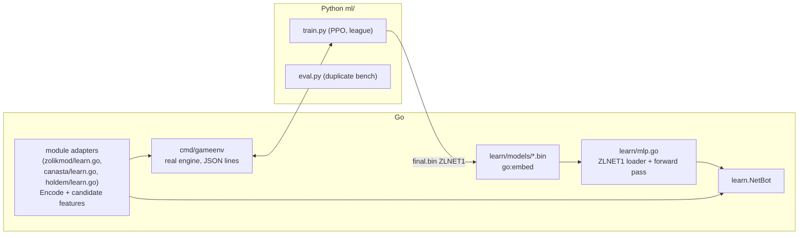

# Bots and AI

Four kinds of non-human player exist:

1. **Hand-written bots** — one per module, played by the runtime for seats
   added with "add bot".
2. **Trained models** — neural policies for Žolíky, Canasta and Poker, shipped
   in the binary and played by seats at skill "AI".
3. **AI agents over MCP** — external LLM clients seated at a real table through
   `POST /mcp`.
4. **The game MCP server** — a stand-alone tool for playing, analysing and
   coaching games against the engine, not connected to the live server.

All of them obey the same two disciplines: **a bot never decides what is
legal** (it picks from the offers the module produced) and **a bot never sees
more than its seat may**.

## How the runtime drives bots

Bots are a runtime concern ([`module/bot.go`](../../server/internal/module/bot.go),
[`match/bots.go`](../../server/internal/match/bots.go)):

```go
type Bot interface {
    Act(s State, seat BotSeat, offers []ActionOffer) (Action, bool)
}
type BotSeat struct { PlayerID string; Skill Skill; Seed int64 }
```

- A module provides its bot by implementing `Botted`; otherwise it gets
  `OfferBot`, which takes the first enabled offer (optionally preferring some
  verbs). Every game except Solitaire ships its own.
- After every applied action, after a start and when a socket opens, the
  manager calls `RunBotsIfNeeded`. At most one bot loop runs per match. The
  loop finds the awaited seats (`Seat.Active` in the view, falling back to an
  offer scan), picks the first seat it must drive (a bot, a stand-in for an
  away player, a sat-out drop-in seat), asks the bot under a time budget
  (5 s), and submits the action through the same `handleAction` path a human
  uses. It sleeps a cosmetic think time between moves (`BOT_THINK_MIN_MS` /
  `BOT_THINK_MAX_MS`, 900–1800 ms; compute happens inside that window).
- Recovery: an undo offer is never "progress" — the loop unwinds on undo offers
  and refuses to replay what it unwound, which fixed a freeze where a bot took
  a pile, undid it and took it again. Offers marked `Manual` (leaving the table)
  are never submitted by a bot. If a bot fails, the loop falls back to legal
  offers so a turn never ends in a dead position.
- `BotSeat.Seed` is derived from the match seed and seat id (`SeatSeed`), so a
  weak bot's mistakes are reproducible: same match, seat and turn, same
  mistake.
- **Hints** ([`match/hint.go`](../../server/internal/match/hint.go)) reuse the
  bot for the asking player's own seat and return the move without playing it;
  rate-limited to 5 per 10 s per player, and switchable per table by the
  `hints` option.

### Skills and personas

[`module/skill.go`](../../server/internal/module/skill.go):

| Skill | Meaning |
|---|---|
| `easy`, `medium`, `hard` | The hand-written bot at three strengths, in a measured, monotonic order (`internal/ai`'s gate asserts win rates rise along it) |
| `ai` | The trained network where the game ships one *and* the operator switch is on; otherwise plays Hard |
| Mixed (option value 0) | Each seat draws its own skill at seating |

A seated bot gets a **persona** (name and face) per skill, drawn from those
not already at the table (under the match lock). An "Expert" level was built,
measured, found not to beat Hard, and not shipped; its ideas went into Hard.

The `botSkill` option's AI choice is removed from `/modules` for a game whose
model is switched off (`withoutIdleAI` in
[`match/handlers.go`](../../server/internal/match/handlers.go)), so the
picker never offers an AI that would actually play Hard.

## Hand-written bots

Each module's bot lives in its package (`bot.go`). Notable ones:

- **Žolíky** — [`internal/ai`](../../server/internal/ai): planning
  (`plan.go`), knowledge and inference about opponents (`knowledge.go`,
  `infer.go`, `ledger.go`), endgame (`endgame.go`), and per-skill profiles
  (`profile.go`). [`ai/sim`](../../server/internal/ai/sim) is the
  whole-match simulator that strength claims are measured with.
- **Canasta and Žolíky inference** use [`internal/cardinfer`](../../server/internal/cardinfer),
  which estimates opponents' unseen cards from public behaviour only.
- **Mariáš** uses the trick-taking search in
  [`internal/tricks/search`](../../server/internal/tricks/search). Its Hard
  budget is large on purpose; strength drops when it is capped.
- **Poker** has style profiles and a precomputed heads-up push/fold table
  ([`cmd/pushfold`](../../server/cmd/pushfold) regenerates it).

Measurement tools in [`server/cmd`](../../server/cmd): `aibench` (strength),
`gamebench` (bot vs bot, duplicate deals), `botcost` (CPU per decision, feeds
`botgov.DefaultCosts`), `botsoak` (load a running server with bot tables),
`zolikbehave` / `canastabehave` / `holdembehave` (how a bot plays, not just how
well), `matchstates`.

## Trained models



- **Trainer**: [`ml/`](../../ml/README.md). Python never re-implements a game:
  [`cmd/gameenv`](../../server/cmd/gameenv) plays every table with the real
  engine and hands Python only the adapter's state vector, one feature vector
  per legal candidate, and rewards. PPO with a league of checkpoints,
  heuristics and self-play; configs for `holdem`, `canasta`, `zolik`. Output is
  the `ZLNET1` format that [`learn/mlp.go`](../../server/internal/learn/mlp.go)
  loads. Parity fixtures (`zolik_ml/parity.py`) keep the Python and Go forward
  passes bit-identical.
- **Runtime**: [`internal/learn`](../../server/internal/learn). A `Policy` is
  read-only after loading, so one instance serves every seat and goroutine with
  no lock. `NetBot` scores only candidates built from enabled offers and falls
  back to the heuristic for anything it cannot do (no model, wrong encoder,
  encoding error). `learn.Narrowed` lets a model trained on an earlier encoder
  play on the prefix of today's (encoders are append-only).
  `learn.Scoped` limits a model to the variations and table sizes it was
  trained on (`zolikmod/modelscope.go`, `canasta/modelscope.go`).
- **Shipping**: models are embedded
  ([`learn/models`](../../server/internal/learn/models/models.go)), so a release
  carries its models and a rollback restores the old ones.
- **Switch**: `learn.HardModel` is what a learnable module's `Bot()` returns.
  Precedence: `ZOLIK_LEARNED_MODEL_<GAME>` (a local model file) wins; else the
  operator switch, if on and the model fits the encoder; else the heuristic.
  The switch is read on every bot move, so a change in the console reaches every
  table at its next bot move. At boot (`loadHardModels`,
  [`app/bots.go`](../../server/internal/app/bots.go)) a game with no stored
  choice is switched **on** if its embedded model fits; only an explicit "off"
  turns it off. Choices are stored in the `settings` collection/namespace.
  Only `ai` seats play the model; Easy/Medium/Hard and hints stay heuristic.
- **Training data from people**: [`cmd/export-games`](../../server/cmd/export-games)
  writes the decisions people made in finished matches.

## The compute governor

[`internal/botgov`](../../server/internal/botgov) (design:
[`bot-compute-gating-plan.md`](../bot-compute-gating-plan.md)) keeps bots
from taking more CPU than the box can spare.

- Every decision belongs to a class (game, skill, engine). Classes measured
  above ~1 ms (`DefaultCosts`, from `cmd/botcost`) need a **lease**; leases add
  up to a share of the process's cores, scaled down when the resource monitor
  ([`internal/capacity`](../../server/internal/capacity), every 2 s) reports
  amber or red.
- A seat without a lease plays the next class down — the rule bot instead of the
  model, Medium instead of Hard — which is always cheap. **Downgrade at a turn
  boundary, upgrade at a round boundary**, so a multi-action turn is never
  finished by an engine that did not start it and an opponent never gets
  stronger mid-hand.
- Modes (`BOT_GOVERNOR`): `off`, `observe` (default: decide, count and log,
  change no move), `enforce`. The operator console can change the mode at run
  time and that choice outranks the environment. `BOT_MONITOR_PIN` pins the
  monitor level for testing (debug endpoints only).
- A seat the server is playing with a cheaper engine is flagged `simplified`
  in `match_state`; `GET /bots/capacity` tells clients whether bots are at
  full strength.
- Observability: `/debug/bots` (decision cost histograms, local only) and a
  ten-minute summary in the log in production.

## AI agents at real tables (MCP)

[`internal/mcp`](../../server/internal/mcp) (design:
[`mcp-agent-seats-plan.md`](../mcp-agent-seats-plan.md)).

- An agent calls `POST /mcp` (JSON-RPC, Streamable HTTP, POST only) with a
  bearer token. A guest token is enough; `POST /agents/invite` mints a
  play-only agent token and install commands for a person who wants to point
  Claude or another MCP client at the server. OAuth discovery and dynamic client
  registration are served (`/.well-known/oauth-*`, `/oauth/*`) for clients that
  insist on it.
- Tools: `register_agent`, `set_available`, `list_tables`, `join_table`,
  `get_state`, `wait_for_turn`, `act`. `act` goes through
  `Manager.HandleAction` like any player.
- An agent is seated as a human-like player flagged `IsAgent` (with an
  `agentLabel` shown on the seat), so presence rules apply. The registry is
  in memory and not persisted; `PresenceTTL` is generous because a model may
  think for a while. Drop-in games (poker, blackjack) sit out a quiet agent;
  others pause. `StartAgentSweep` checks every 15 s.
- Hosts see available agents at `GET /agents/available` and seat one with
  `POST /matches/{id}/add-agent`.

## The game MCP server (offline analysis)

[`cmd/game-mcp`](../../server/cmd/game-mcp) with
[`internal/gamemcp`](../../server/internal/gamemcp): an MCP server over stdio
(also `game-mcp cli` and `game-mcp call`) exposing `list_games`, `rules`,
`new_table`, `observe`, `play`, `coach`, `replay_log` and `close_table`. Tables
run in process on the real engine against the heuristic bots or trained
networks; `coach` scores the options with a trained model. It renders engine
message keys as English using a copy of the client's `en.ts`
(`messages_en.json`, regenerated by `go generate ./internal/gamemcp`, checked by
`TestMessagesMatchClientBundle`).
