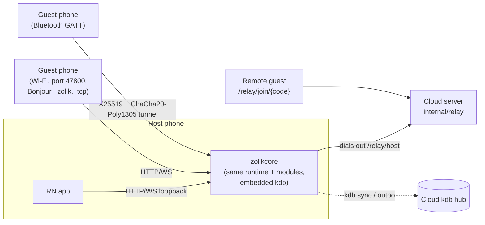

# Clients

| Client | Tech | Where | Talks to |
|---|---|---|---|
| Web app | Expo 56 / React Native 0.85 / react-native-web, Expo Router | [`client-react-native`](../../client-react-native) (built with `expo export`, embedded in the server binary) | The server that served it (same origin) |
| iOS and Android apps | Same codebase, bundle id `com.jokerless.app` | `client-react-native` + native module [`modules/zolik-nearby`](../../client-react-native/modules/zolik-nearby) | jokerless.com, or the embedded Go core for offline tables |
| Mac app | Swift/AppKit shell around a `WKWebView` showing the same web client | [`client-macos`](../../client-macos/README.md) | The embedded Go core, which makes every network request |
| Terminal client | Go, Bubbletea over SSH (Wish) | [`client-tui`](../../client-tui/README.md), linked into `cmd/server` | The same REST + WebSocket API, over loopback |

None of them knows which game it is showing. They render `match_state`
(`view` zones, seats, facts; `legalActions`; standings; rounds; recent moves)
and send `module.Action`s built from offers. Labels come from message keys.
Where a client would need a rule, the server ships the fact instead.

## React Native / Expo

Layout ([`client-react-native/`](../../client-react-native)):

| Path | Contents |
|---|---|
| [`app/`](../../client-react-native/app) | Expo Router screens: home, lobby, `match/[matchId]`, `replay`, `rules`, `stats`, `circle`, `seat`, `deal`, `offline`, `local-games`, auth flows, legal pages, settings |
| [`src/api/`](../../client-react-native/src/api) | HTTP client and wire types (`matchTypes`) |
| [`src/hooks/useMatchSocket.ts`](../../client-react-native/src/hooks/useMatchSocket.ts) | The gameplay socket: `match_state`, events, errors with `ruleIds`, reconnect (stops on close code 4001, "displaced") |
| `src/hooks/useLobbySocket.ts`, `useMyTables.ts`, `useRuleIndex.ts` | Waiting room, "My games", rule-id lookups for refusals |
| [`src/components/match/`](../../client-react-native/src/components/match) | The one match screen for every game: zones, hand, offer bar, results |
| [`src/lib/`](../../client-react-native/src/lib) | i18n, labels, drag-and-drop targets (`drops.ts`), hand ordering, layout, board arrangement |
| [`src/skins/`](../../client-react-native/src/skins) | Visual skins |
| [`src/a11y/`](../../client-react-native/src/a11y) | Accessibility helpers |
| [`src/guide/`](../../client-react-native/src/guide) | Guided lessons and tours (seeded lesson tables from the server) |
| [`src/net/`](../../client-react-native/src/net) | Offline hosting, Bluetooth transport, relay link, local replica |
| [`src/desktop/`](../../client-react-native/src/desktop) | The Mac app's menu bridge and window model |

Drag-and-drop is derived from offers: a held card's legal drop targets are
the offers whose `Source` selector includes it, and each target's `Placement`
positions say which end of a group it may go on. A chosen position travels back
as `params.position`.

The web build is pre-rendered (`expo export`); dynamic routes get their own
HTML so hydration does not adopt another screen's markup. In a browser the app
calls the API on the origin that served it, so jokerless.com, jokerless.org and
play.limidus.com each work as complete copies (sign-in is per domain). Web
sessions keep the refresh token and guest key in HttpOnly cookies scoped to
`/auth` when the request opts in (see
[identity-and-security.md](identity-and-security.md#browser-cookies)); native
apps keep tokens in the platform keychain (SecureStore).

### i18n

- **The server never sends a sentence.** It sends keys: error codes
  (`NOT_YOUR_TURN`), option and choice names, fact label keys with params, rule
  item ids. Wording lives in the client
  ([`src/lib/i18n.ts`](../../client-react-native/src/lib/i18n.ts)).
- **Locales**: 24 bundles in
  [`src/lib/locales`](../../client-react-native/src/lib/locales) — English plus
  23 (bg, cs, da, de, el, es, et, fi, fr, ga, hr, hu, it, lt, lv, mt, nl, pl, pt,
  ro, sk, sl, sv), and lesson text under `locales/guide`. Lookup falls back
  locale → English → caller fallback → the key itself; a test requires every key
  to exist in every bundle.
- **`serverKeys.json`** ([`src/lib/serverKeys.json`](../../client-react-native/src/lib/serverKeys.json))
  is a golden file of every key the server can send, generated by
  [`server/cmd/dump-keys`](../../server/cmd/dump-keys/main.go). A Go test fails
  if it is out of date; a client test fails if any key in it lacks wording in
  any locale. Keys must be static literals in Go (a key or params map passed
  through a variable is invisible to the scanner).
- `/modules` is the one endpoint that sends English labels;
  [`gameLabels.ts`](../../client-react-native/src/lib/gameLabels.ts) re-keys
  them, and `npm run i18n:labels` (needs a running server) reports labels with
  no key or keys two modules disagree about. Game names are not translated.
- Push notification texts are generated separately
  ([`scripts/gen-notify-texts.js`](../../scripts/gen-notify-texts.js) →
  [`server/internal/notify/texts.json`](../../server/internal/notify/texts.json)).
- Procedure for adding a key: [developer guide](../developer/README.md#adding-a-message-key).

### Skins

[`src/skins/types.ts`](../../client-react-native/src/skins/types.ts): a skin is
a look and only a look — colours, card-face treatment, borders, shadows,
decoration, the draw-pile drawing. **It may never change the size of anything**
(typography included), because drop targets are hit-tested by measured size and
every testID and measurement must be identical under every skin. Skins:
`casino` (default: felt, gold trim), `classic` (the original flat look, also the
source of `src/theme.ts`'s static palette), `fourColour`, `heirloom`. Every
palette is held to WCAG 2.2 contrast thresholds per token by
[`contrast.test.ts`](../../client-react-native/src/skins/contrast.test.ts).

### Accessibility

Plan and decisions: [`accessibility-plan.md`](../accessibility-plan.md).
Helpers in [`src/a11y`](../../client-react-native/src/a11y): live-region
announcements, spoken card names, accessible sheets, radio groups and
tooltips, document titles, contrast preferences (system and startup). The
match board is announced for screen readers (`boardSpeech.ts`). Playwright
reads cards by `data-card` rather than visible text, and `a11y*.spec.ts`
check the shell, the board and target sizes (phone project).
React Native Web's `Pressable` owns `aria-disabled`, so disabled controls that
must still explain themselves are wrapped (`ExplainOnPress`).

## Mac app

[`client-macos`](../../client-macos/README.md). One process: AppKit windows,
a `WKWebView` running the web client, and the Go core
(`Zolikcore.xcframework`, from [`server/mobile/zolikcore`](../../server/mobile/zolikcore))
linked in.

- Pages load from `app://jokerless/`, served in process by the core
  (`zolikcore.WebAsset`) with the server's own routing.
- **The web view has no network.** A content security policy allows only the
  app itself; `bridge.js` replaces `fetch` and `WebSocket` with messages to
  Swift, which hands them to `zolikcore.NetFetch` / `NetSocketOpen`. Those
  refuse any host that is not the configured server, loopback or a private
  address.
- One main window for everything except games; a window per match or replay;
  menus localised by the page (`desktop.menu.*`).
- Bonjour and Bluetooth reuse the iOS module's Swift files.

Build: `scripts/build-macos.sh` (and `scripts/macos-dmg.sh` for a disk image).
A Windows shell was planned but does not exist in the tree.

## Terminal client

[`client-tui`](../../client-tui/README.md) is a separate Go module
(`zolik/client-tui`) imported by the server through a `replace`. When
`SSH_ENABLED` (default on under a local `APP_ENV`, off in production) the
server listens on `SSH_PORT` (2222). User `guest` with any password plays as a
guest; other users log in with the legacy username/password endpoint, kept for
this client. The match screen ([`ui/match.go`](../../client-tui/ui/match.go))
renders zones and offers generically.

## Embedded core, offline and hybrid tables

- **The core** ([`server/mobile/zolikcore`](../../server/mobile/zolikcore)) is
  the server, bound with gomobile, configured by `app.MobileConfig`
  (`APP_ENV=mobile`): embedded kdb in the app's data directory, no Redis, no
  mail, no identity providers, debug and test endpoints off, routes reduced by
  `RegisterMobileRoutes`. Built by `scripts/build-mobile-core.sh` (needs
  gomobile, Xcode, the Android NDK and `../kdb`). `cmd/phonehost` runs the same
  thing on a desktop.
- **Offline**: "Play offline" hosts a table on loopback against bots. Games
  declared `ServerDealt` (Solitaire) are left out of a phone's `/modules`,
  because a device that chose the seed would know the deal.
- **Nearby**: the host listens on port 47800 (or any free port) and advertises
  `_zolik._tcp`; guests can also type the address or scan a QR code
  (`clientreactnative://offline?h=…`). `PROTOCOL_VERSION` in the native module
  and `zolikcore.ProtocolVersion` must move together.
- **Bluetooth**: the host is a GATT peripheral; links are unpaired and
  unencrypted, so the core runs its own tunnel
  ([`tunnel.go`](../../server/mobile/zolikcore/tunnel.go),
  [`src/net/ble/crypto.ts`](../../client-react-native/src/net/ble/crypto.ts)):
  X25519 handshake, ChaCha20-Poly1305, the host's static key pinned per table,
  and a 4-character check code on both screens.
- **Hybrid tables** ([`internal/relay`](../../server/internal/relay/relay.go),
  plan: [`drop-handling-and-hybrid-plan.md`](../drop-handling-and-hybrid-plan.md)):
  the phone opens one WebSocket out to the cloud (`/relay/host`, enrolled nodes
  only) and gets a six-character relay code; remote guests connect to
  `/relay/join/{code}`. The relay copies the same sealed tunnel bytes and never
  reads them. Limits: 8 remote guests, 256 KiB per frame, a per-guest frame
  rate, a 10-minute grace for a host that drops. While the relay link is down,
  no stand-in bot takes a remote guest's seat, and when a backgrounded host
  comes back every away clock restarts, so nobody is cashed out or abandoned
  for the host's absence ([`match/hostpause.go`](../../server/internal/match/hostpause.go)).
- **Sync** ([`internal/sync`](../../server/internal/sync)): with
  `FEATURE_FLAG_SYNC=hub|spoke`, kdb namespaces replicate over
  `GET /kdb/sync` (an ordinary authenticated WebSocket). A device holds the
  signed-in user's `u/<id>` and `u/<id>/ro` namespaces and the matches it
  follows; [`internal/replica`](../../server/internal/replica) serves that
  person's own data offline and refuses questions about other people.
- **Finished offline games** go to the device's outbox only with consent — per
  player, host and seat ([`match/localsaves.go`](../../server/internal/match/localsaves.go),
  `/local/saves/*`); the cloud's importer verifies each by replaying it before
  recording it.
