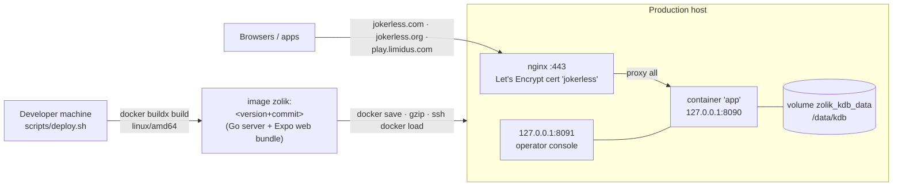

# Deployment and operations

There is one production deployment and no staging environment. A test deploy
is a second local kdb stack on its own port.

## Shape

- **One image is the deployment.** [`server/Dockerfile`](../../server/Dockerfile)
  builds the Expo web export (Node 22 stage), then the Go binary with the web
  bundle embedded (`internal/webui/dist`) and kdb supplied as a BuildKit named
  context (`kdbsrc` = `../kdb`), cross-compiled for `linux/amd64`, into a
  distroless `nonroot` image. The API and the web app are therefore always the
  same commit.
- **The host holds a compose file, an env file and loaded images** — no source,
  no kdb checkout, no Go, no npm. [`deploy/compose/zolik.yml`](../../deploy/compose/zolik.yml)
  runs one container (`mem_limit: 2g`) with `FEATURE_FLAG_DB_ENGINE=kdb`, no
  Mongo and no Redis, and states every hardening switch as a literal (see
  [identity-and-security.md](identity-and-security.md#hardening-switches)).
  The compose project is named `zolik` and the volume `zolik_kdb_data`
  explicitly, because an implicit rename once would have created an empty
  database.
- **nginx** terminates TLS and proxies everything to `127.0.0.1:8090`; it serves
  no files and enumerates no routes. Vhosts:
  [`deploy/nginx/`](../../deploy/nginx) (`jokerless.conf`,
  `jokerless-http.conf`, `play-limidus.conf`, `zolik-proxy.conf`).

## Domains

| Name | Role |
|---|---|
| `jokerless.com` | Canonical: `PUBLIC_BASE_URL`, the OAuth callback, the host in invite links |
| `jokerless.org` | Full mirror (same container) |
| `play.limidus.com` | Kept for existing links and installs (same container) |
| `www.jokerless.com`, `www.jokerless.org` | 301 to the apex of the same domain |

The web client calls the API on whichever origin served it, so each name is a
complete copy; sign-in is per domain. Extra domains are added to
`AUTH_ALLOWED_RETURN_URLS` by `deploy.sh` (`ZOLIK_EXTRA_URLS`). DNS is
DNS-only (not proxied) A records; `deploy.sh` obtains the certificate over
HTTP-01 and refuses to continue until every name resolves.

## `scripts/deploy.sh`

[`scripts/deploy.sh`](../../scripts/deploy.sh) (`set -euo pipefail`
throughout):

1. Pre-flight: `docker buildx`, the `../kdb` sibling, SSH to the host, and an
   env check (production `APP_ENV` requires `SMTP_*`, because the server
   refuses to start without mail rather than crash-looping later).
2. Build the image, tagged with the build version from
   [`scripts/version.sh`](../../scripts/version.sh).
3. Ship it (`docker save | gzip | ssh docker load`), skipping the transfer if
   the tag is already loaded.
4. Install the compose file, write `.env` (`--init-env` regenerates it from
   [`deploy/env.production.example`](../../deploy/env.production.example) with
   fresh secrets), optionally `--snapshot` the volume to a backup tarball first.
5. `ZOLIK_RELEASE=<tag> docker compose up -d`; keep the last
   `ZOLIK_KEEP_IMAGES` (3) tags for rollback.
6. Unless `--skip-nginx`, install vhosts and certificates.

Configuration comes from `ZOLIK_DEPLOY_HOST`, `ZOLIK_DEPLOY_SSH`,
`ZOLIK_DEPLOY_USER`, `ZOLIK_PUBLIC_URL`, `ZOLIK_EXTRA_URLS`,
`ZOLIK_SERVICE_IP`, the legal-notice variables (`ZOLIK_OPERATOR`,
`ZOLIK_OPERATOR_COUNTRY`, `ZOLIK_OPERATOR_CONTACT`, baked into the web bundle;
missing any of them shows a draft banner on Terms and Privacy) and
`ZOLIK_SOURCE_URL` (the AGPL §13 source offer shown in the footer).

**Rollback** is `ZOLIK_RELEASE=<older-tag> docker compose up -d` as the
runtime user on the host, while that image is still loaded.

**Never** run `docker compose down -v` or `docker volume prune` in the deploy
path: the volume is the database. Rationale and history:
[`docker-deploy-plan.md`](../docker-deploy-plan.md).

Operational caution: if you pipe `deploy.sh` into `tee` or similar, the shell
reports the last command's status, not the script's. Confirm the running image
tag on the host after a deploy.

## Releases and versions

- [`VERSION`](../../VERSION) holds the three-part number (currently `1.19.0`),
  bumped by hand in a PR to `main` for a release.
- The fourth part is the number of commits since `VERSION` last changed (so a
  bump resets it to 0), and the build carries the short commit:
  `1.19.0.24+abc1234`; `-dirty` is appended for an uncommitted tree.
  [`scripts/version.sh`](../../scripts/version.sh) is the only place this is
  computed; `dev-stack.sh`, the npm scripts and the Docker build all use it.
- Every piece shows its build: `GET /version` on the server, the footer in the
  web/phone client, About on the Mac, the header in the TUI.
- A release is cut by merging the VERSION bump and running `deploy.sh` from a
  clean, detached checkout of that commit with a matching `../kdb` checkout at
  the kdb version `go.mod` expects (the shared sibling checkout moves under
  you otherwise). [`release-1.8.0-production-upgrade.md`](../release-1.8.0-production-upgrade.md)
  is a worked example.
- Mobile builds: EAS profiles in [`client-react-native/eas.json`](../../client-react-native/eas.json)
  (`preview`, `production` point at jokerless.com); iOS also via
  [`scripts/build-ios.sh`](../../scripts/build-ios.sh); Mac via
  [`scripts/build-macos.sh`](../../scripts/build-macos.sh) and
  [`scripts/macos-dmg.sh`](../../scripts/macos-dmg.sh). The embedded core is
  built first with [`scripts/build-mobile-core.sh`](../../scripts/build-mobile-core.sh).
  App Store notes: [`app-store-submission.md`](../app-store-submission.md).

## Migrations

Offline, one-shot commands in [`server/cmd`](../../server/cmd), run against a
stopped store when a release notes it: `migrate-match-log` (moves stored once,
snapshots), `migrate-namespaces` (per-match kdb namespaces), `kdb-consolidate`
(old per-namespace layout to one data root), `migrate-games` (pre-module
`games` documents), `backfill-zolik-scores`, `repair-partnership-draws`.
kdb history mode cannot be changed in place: `KDB_HISTORY_MODE=none` needs an
offline conversion first ([`kdb-history-none-cutover.md`](../kdb-history-none-cutover.md)).

## Observability

| What | Where |
|---|---|
| Logs | Structured `slog` JSON to stdout ([`internal/obs`](../../server/internal/obs/obs.go)); `LOG_LEVEL`; read with `docker logs \| jq`. Existing `log.Printf` calls are routed through slog. |
| Start-up facts | Engine, kdb durability/sync mode, document format, history retention, memory budget, GOMEMLIMIT, admission limits, governor mode are each logged once at boot |
| Counters | One `daily_metrics` document per UTC day, incremented in memory and flushed every 30 s ([`internal/metrics`](../../server/internal/metrics)); weeks and months are summed on read |
| Crashes | A `boots` row per start, closed on clean shutdown; an open row found at start means the previous run died (reported one restart late) |
| Operator console | `/admin` on the admin listener: games, people, new players, unfinished (abandoned / never started / in flight), crashes, refusals; `GET /admin/api/report?from=&to=&bucket=day\|week\|month[&format=csv]`; the Hard/AI model switches (`/admin/api/bots`) and governor mode. Reach it with `ssh -N -L 8091:127.0.0.1:8091 <host>`. See [`server/README.md`](../../server/README.md#operator-console-and-reporting) and [`logging-and-reporting-plan.md`](../logging-and-reporting-plan.md). |
| Capacity | `GET /healthz/capacity` (public), `GET /bots/capacity`; the capacity monitor logs level changes |
| Bot costs | `/debug/bots` (local), a 10-minute summary in the production log |
| Memory | `/debug/memory` (see below) |

### `/debug/memory`

[`app/debugmem.go`](../../server/internal/app/debugmem.go). Registered only
when `ENABLE_DEBUG_ENDPOINTS` is on (default on under a local `APP_ENV`,
forced off in production compose), because it can stop the world and reveals
the shape of the process. It splits the cgroup memory figure the admission gate
uses into live Go heap, garbage not yet collected, and kernel page cache.
`?gc=1` collects first, so what remains is live — read it that way before
calling anything a leak. `/debug/pprof/*` is on the same flag
(`/debug/pprof/heap?gc=1`). Background and thresholds:
[`docs/memory.md`](../memory.md).

## Environment reference (selected)

All read in [`internal/app/config.go`](../../server/internal/app/config.go)
unless noted.

| Variable | Default | Notes |
|---|---|---|
| `APP_ENV` | unset = local | `production`, `mobile` (embedded) |
| `PORT` | 8090 | |
| `PUBLIC_BASE_URL` | `http://localhost:$PORT` | OAuth callback, invite links |
| `FEATURE_FLAG_DB_ENGINE` / `FEATURE_FLAG_KDB` | mongo | `kdb` in production |
| `KDB_PATH` | `data/kdb` | |
| `KDB_DURABILITY`, `KDB_SYNC_MODE`, `KDB_DOC_WRITE_FORMAT`, `FEATURE_FLAG_KDB_HISTORY_RETENTION`, `KDB_HISTORY_MODE` | | kdb storage ([`db/kdb.go`](../../server/internal/db/kdb.go)) |
| `MONGO_URI`, `MONGO_DB` | `mongodb://localhost:27017`, `zolik` | |
| `REDIS_URL` | empty | Enables cross-instance fan-out and lobby presence |
| `JWT_ACCESS_SECRET`, `JWT_SIGNING_KEY(_FILE)` | dev default | Required outside local |
| `SMTP_*` | | Required outside local |
| `OAUTH_{GOOGLE,APPLE,MICROSOFT}_*` | | Providers appear when set |
| `VAPID_*`, `EXPO_PUSH_ENABLED`, `EXPO_ACCESS_TOKEN` | Expo push on outside local | Push; unconfigured senders log instead |
| `ADMIN_USERNAME`, `ADMIN_PASSWORD_HASH`, `ADMIN_PORT`, `ADMIN_BIND`, `ADMIN_EMAILS` | console off | |
| `ADMISSION_MAX_CONNECTIONS`, `ADMISSION_WAITING_ROOM_RATIO`, `ADMISSION_MEMORY_WATERMARK`, `ADMISSION_CPU_WATERMARK` | 0 (derived), 0.8, 0.85, 0.25 | |
| `BOT_THINK_MIN_MS`, `BOT_THINK_MAX_MS` | 900, 1800 | Keep defaults for Playwright |
| `BOT_GOVERNOR`, `BOT_MONITOR`, `BOT_MONITOR_PIN` | observe, true, — | |
| `FEATURE_FLAG_MATCH_REPLAY` | false | On in production |
| `FEATURE_FLAG_SYNC`, `SYNC_HUB_URL`, `SYNC_TOKEN`, `SYNC_ADVERTISE`, `SYNC_NAMESPACES` | off | kdb replication |
| `ZOLIK_RETAIN_*` | 24 h / 90 d / 30 d | Retention |
| `ZOLIK_LEARNED_MODEL_<GAME>` | | Local model file override ([`learn`](../../server/internal/learn/hardmodels.go)) |
| `ZOLIK_SOURCE_URL` | GitHub repo | AGPL source offer |
