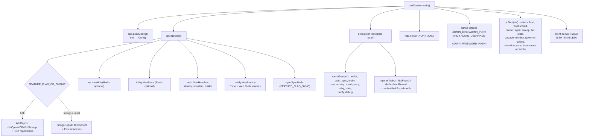
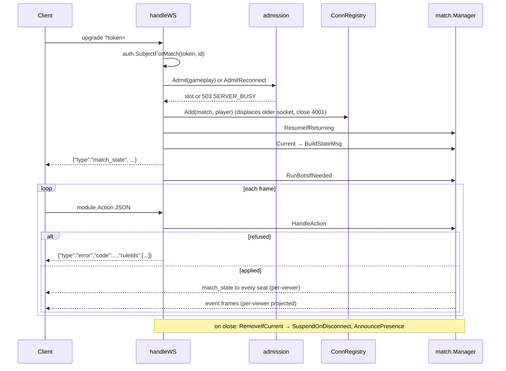

# Server

The server is one Go binary, [`server/cmd/server`](../../server/cmd/server/main.go).
It serves the REST API, the WebSockets, the compiled-in web client, the MCP
endpoint, the sync and relay endpoints, an optional SSH terminal client, and
(on a second listener) the operator console. Module path: `zolik/server`,
Go 1.26.

## Process structure



Key files:

| File | Role |
|---|---|
| [`cmd/server/main.go`](../../server/cmd/server/main.go) | Loads `.env`, sets up logging (`internal/obs`), CORS (public `*` everywhere, credentialed same-host only for `/auth/*`), an 8 MiB request-body cap ([`app/limits.go`](../../server/internal/app/limits.go)), the listeners, and graceful shutdown (`a.Stop` before `Close`, so a clean exit is recorded before the store closes) |
| [`internal/app/config.go`](../../server/internal/app/config.go) | Every environment variable the server reads, with defaults |
| [`internal/app/app.go`](../../server/internal/app/app.go) | Wiring: repositories for the chosen engine, the hub, auth, notify, the match manager (built once, memoised), route groups, the web UI fallback |
| [`internal/app/admin.go`](../../server/internal/app/admin.go) | The operator console router, mounted only on the admin listener |
| [`internal/app/debugmem.go`](../../server/internal/app/debugmem.go) | `/debug/memory`, `/debug/bots`, `/debug/capacity`, `/debug/pprof/*` (only when `ENABLE_DEBUG_ENDPOINTS`, default on only under a local `APP_ENV`) |
| [`internal/app/mobile.go`](../../server/internal/app/mobile.go) | The reduced configuration and routes used when the server is embedded in a phone or Mac (`APP_ENV=mobile`) |
| [`internal/app/sync.go`](../../server/internal/app/sync.go) | Wiring for kdb replication (hub/spoke) and the importer of finished matches |

Route groups are a list (`routeGroups`) so a test can mount each on its own
router and prove none shadows another; chi keys a path segment by position,
not by placeholder name, so `/matches/{id}` and `/matches/{gameId}` would be one
route ([`app/routes_test.go`](../../server/internal/app/routes_test.go)).

The web client is served off the router's leftovers (`NotFound` and
`MethodNotAllowed`), never by a catch-all route, so the API always wins. An
existing file is served whatever the `Accept` header; an unknown path gets the
SPA only when the browser asks for HTML, and a dynamic route such as
`/match/<id>` gets its own prerendered page to avoid React hydration error
#418.

## HTTP surface

The authoritative list is the `RegisterRoutes` methods; this is a map, not a
contract.

| Area | Routes | Package |
|---|---|---|
| Health and build | `GET /healthz`, `/healthz/capacity`, `/bots/capacity`, `/version` | [`app`](../../server/internal/app/app.go) |
| Games | `GET /modules`, `/modules/{id}/rules`, `/modules/{id}/lessons` | [`match/handlers.go`](../../server/internal/match/handlers.go) |
| Matches | `POST /matches`; `GET /matches/{id}` (optional auth: no token = spectator view); `GET /matches/open`; `POST /matches/{id}/{join,start,resume,rematch,deal-again,deal-link,add-bot,invite,seats,listed,hint,look}`; `DELETE /matches/{id}`; `GET /matches/{id}/replay`; seat links `/seats/{id}/{secret}`; `/users/me/tables` | `match` |
| Gameplay socket | `GET /ws/matches/{id}?token=` | `match` |
| Waiting room | `GET /lobby/waiting`, `GET /ws/lobby?token=` | [`lobby`](../../server/internal/lobby/handler.go) |
| Personal socket, circle, push | `GET /ws/me`, `/notify/*` | [`notify`](../../server/internal/notify/handlers.go) |
| Auth | `/auth/*`, `/.well-known/jwks.json`, `/nodes/*` | [`auth/handlers.go`](../../server/internal/auth/handlers.go) |
| Statistics | `/leaderboard`, `/stats/ai`, `/matches/{matchId}/result`, `/users/me/{stats,matches,history,head-to-head}` | [`stats`](../../server/internal/stats/handlers.go) |
| AI agents | `POST /mcp`, OAuth metadata and `/oauth/*`, `/agents/available`, `/agents/invite`, `/matches/{id}/add-agent` | [`mcp`](../../server/internal/mcp/handlers.go) |
| Hybrid tables | `GET /relay/host`, `/relay/join/{code}`, `/relay/info/{code}` | [`relay`](../../server/internal/relay/handlers.go) |
| Replication | `GET /kdb/sync` (only on a sync node) | [`sync`](../../server/internal/sync/node.go) |
| Scorepad | `/scoring-sessions/*` (pen-and-paper Žolíky scorecard, unrelated to hosted matches) | [`scoring`](../../server/internal/scoring/handlers.go) |
| Dev only | `POST /matches/{id}/debug-state`, `GET /auth/dev/last-code` (`ENABLE_TEST_ENDPOINTS`) | `match`, `auth` |

Module errors are returned as `{"code": ..., "message": ...}`; the HTTP
status is chosen from the code in `writeModuleError`
([`match/handlers.go`](../../server/internal/match/handlers.go)). Clients render
from the code, never the message.

## The gameplay WebSocket

`GET /ws/matches/{id}?token=<JWT>` (a browser cannot send headers on an
upgrade, hence the query parameter). The flow in `Handlers.handleWS`:



Details worth knowing:

- **Inbound** frames are `module.Action` (`offerId`, `verb`, `cards`,
  `target`, `params`). **Outbound** frames are `match_state` (built in
  [`match/state_msg.go`](../../server/internal/match/state_msg.go): envelope
  fields, players, `view`, `legalActions`, `standings`, `rounds`,
  `recentMoves`, presence and rematch fields), module events (type = the
  module's event type), and `error`.
- A refusal frame carries `ruleIds` from the module's rule index when it has
  one (see [game-modules.md](game-modules.md#written-rules-and-refusals)).
- Malformed ids and vanished tables are reported over the socket after the
  upgrade (`MATCH_NOT_FOUND`), because a browser cannot read why an upgrade
  was refused.
- One writer per socket: `ws.syncConn` wraps every connection in a mutex
  ([`ws/registry.go`](../../server/internal/ws/registry.go)).
- A newer socket for the same seat displaces the older one with close code
  `4001` (`CloseCodeDisplaced`), so the old tab stops reconnecting. Only the
  socket that is still current suspends the table when it closes.

The waiting room (`/ws/lobby`) and the personal socket (`/ws/me`) ride the
same `ws.Hub` and `ConnRegistry` under reserved room ids, so they share the
Redis fan-out path without a transport of their own.

## Match lifecycle

Statuses (`models.Match.Status`): `lobby`, `active`, `suspended`,
`abandoned`, `completed`. (The field comment in
[`models/match.go`](../../server/internal/models/match.go) still says
`lobby | active | completed`.)

```mermaid
stateDiagram-v2
  [*] --> lobby: POST /matches (Create / CreateListed / CreateLesson)
  lobby --> lobby: join, add-bot, add-agent, invite, seats
  lobby --> active: POST /start (module.NewMatch, snapshot 0)
  active --> active: action (Apply → AppendMove / CommitSnapshot → broadcast)
  active --> suspended: awaited seat's socket closed (SuspendOnDisconnect)
  suspended --> active: player returns (ResumeIfReturning)
  suspended --> abandoned: reaper after AbandonWindow (2 min; 30 days for one-seat games)
  active --> abandoned: reaper, stranded 15 min with nobody present
  abandoned --> active: POST /resume (ResumeAbandoned)
  active --> completed: module.Finished → winners
  completed --> lobby: POST /rematch (new match, held seats)
  completed --> [*]: retention deletes (90 days default)
  abandoned --> [*]: retention deletes (30 days default)
  lobby --> [*]: retention deletes (24 h) or host DELETE
```

Step by step, all in [`internal/match`](../../server/internal/match):

1. **Create** (`Manager.create`, [`manager.go`](../../server/internal/match/manager.go)).
   The module's descriptor validates options and variation
   (`ValidateOptions`, `UNKNOWN_VARIATION`). A seed is drawn (or a lesson's seed
   used), a six-character join code minted, the envelope inserted.
2. **Seat.** `Join` / `JoinWith` (bots: the persona is chosen *under the lock*
   so two concurrent add-bots cannot seat the same opponent), `Invite` (from
   the waiting room through the narrow `WaitingLookup` interface), `Seat`
   (host reorders seats; teams are a function of seat order via
   `module.Seated`). Re-joining is idempotent. A table under way takes a new
   player only if the module implements `module.LateSeater`
   ([`latejoin.go`](../../server/internal/match/latejoin.go)). Capacity is the
   *variation's* seat range.
3. **Deal** (`Start` → `startLocked`). `module.NewMatch(cfg, players, seed)`
   produces the initial state, stored as snapshot 0. Every later rebuild starts
   from a snapshot, never from `NewMatch` again.
4. **Moves** (`HandleAction` → `applyLocked`). See below.
5. **Results.** When `Finished` reports done, the final move is committed with
   a snapshot and the envelope (`Status=completed`, `Winners`, `WinnerID` =
   first winner for older clients). After the broadcast, the stats recorder
   writes the permanent record asynchronously (skipped for lessons), and
   `onCompleted` lets kdb release the match's namespace
   (`db.KDB.ReleaseMatch`).
6. **Rematch** ([`rematch.go`](../../server/internal/match/rematch.go)). The
   first seated human to press opens a new lobby with the same game, variation,
   options, seat order and bots (persona and skill kept); every other human gets
   a held seat (`Reserved`), and the finished table remembers where its rematch
   is. One-seat games instead offer "deal again" / "send this deal"
   ([`dealagain.go`](../../server/internal/match/dealagain.go)); the seed is
   copied on the server and never shown.

Around that core: stand-in bots for dropped players
([`standin.go`](../../server/internal/match/standin.go)), leaving cash tables
([`leave.go`](../../server/internal/match/leave.go)), seat links and hand-over
([`seatlink.go`](../../server/internal/match/seatlink.go),
[`seathandover.go`](../../server/internal/match/seathandover.go)), hints
([`hint.go`](../../server/internal/match/hint.go)), replay
([`replay.go`](../../server/internal/match/replay.go)), the reaper
([`reaper.go`](../../server/internal/match/reaper.go), every 30 s) and
retention ([`retention.go`](../../server/internal/match/retention.go)).

### One move, end to end

`Manager.HandleAction(ctx, idOrCode, playerID, action)`:

1. `lockMatch` resolves an id or join code, takes the match's entry lock, and
   loads it if needed (envelope, newest snapshot, moves after it — Apply is
   deterministic, so the rebuild is exact).
2. A stand-in or stepped-out seat is reconciled under the same lock.
3. `module.ApplyAndProject` applies the action. **A refusal stores nothing and
   broadcasts nothing**; the error goes back to the caller.
4. The move is persisted: `AppendMove` normally, or `CommitSnapshot` (move +
   board + envelope under the version check) when the match finished, at least
   100 moves passed since the last snapshot, or a round closed at least 50
   moves after it (`snapshotDue`).
5. The in-memory entry is updated; each seat's narrated move log is extended
   (`liveMatch.record`, last 200 per seat, memory only).
6. Unlock, then broadcast each seat its own view (`broadcastWith`, one decode
   of the state shared by every seat), then per-viewer projected events.
7. Record the result if completed; then `RunBotsIfNeeded`.

The runtime decides nothing about legality: everything game-specific is a call
into the module, and `State` is bytes it never opens.

## Concurrency model and locking rules

The match runtime is the only place with interesting concurrency. The rules,
as the code implements them:

1. **One lock per match.** `liveMatch.mu`
   ([`live.go`](../../server/internal/match/live.go)). Every read and every
   write of a match goes through it: moves, envelope writes (suspend, reap,
   seat, rematch), and readers via `Manager.Current`. This is what stops a move
   being accepted into a match that was just abandoned, since the envelope no
   longer carries the state and a version check alone would not catch it.
2. **The table of entries has its own short lock** (`liveMatches.mu`), never
   held while waiting for an entry lock. `lockMatch` takes the entry, locks it,
   then re-checks the table still holds that entry (it may have been evicted in
   between) and retries if not, so a match never has two entries.
3. **Observers and broadcasts run after unlock.** `Join` releases the lock
   before telling join/lobby observers, and `HandleAction` broadcasts after
   releasing it, "so an observer can never be the reason a table's lock is
   held". Observer interfaces (`LobbyObserver`, `RematchObserver`) are
   documented "must not block".
4. **Narration has a separate lock** (`liveMatch.recentMu`) because the state
   message reads it from outside the entry lock.
5. **One bot loop per match.** `Manager.botMu` guards `botRunning`; a second
   `RunBotsIfNeeded` for the same match is a no-op. The loop re-enters through
   the same `handleAction` path as a human, takes the lock per step, and stops at
   a turn boundary when asked (`botStopping`, used by `Release` when a match is
   handed to another node). Loops run on `context.WithoutCancel` because they
   outlive the request that triggered them. Each bot decision is bounded
   (`botActBudgetDefault` = 5 s) and the cosmetic think time is
   `BOT_THINK_MIN_MS`..`BOT_THINK_MAX_MS` (900–1800 ms).
6. **Timers and presence maps** (`awaySince`, stand-in and leave timers) share
   `Manager.awayMu`.
7. **kdb namespaces:** `db.KDB.mu` guards the namespace map; each namespace has
   its own write lock. `UpdateMulti` takes every handle first, then every
   namespace lock in sorted order, because `Close` holds `k.mu` while waiting
   for each namespace's lock: **nothing may want `k.mu` while holding a
   namespace lock** ([`db/kdb.go`](../../server/internal/db/kdb.go)).
8. **Idle eviction** uses `TryLock`, so an entry in use is never evicted.
   Entries idle 10 minutes (finished ones after 1 minute) are dropped by the
   reaper tick and rebuilt on next use.

Optimistic concurrency still backs this up at the store: `AppendMove` refuses a
duplicate sequence number and `CommitSnapshot`/`UpdateWithVersion` check the
envelope version; either yields `ErrVersionConflict`, which marks the entry
stale so the next lock reloads it.

## Persistence

### Two engines, one binary

`FEATURE_FLAG_DB_ENGINE=kdb|mongo` (or `FEATURE_FLAG_KDB=true`) picks the
backend at start-up. **Unset means Mongo**; production sets `kdb` explicitly.
`app.repos` is built by `kdbRepos` or `mongoRepos` with the same fields, so a
repository added to one engine and not the other is a compile error.

| | kdb (production) | Mongo |
|---|---|---|
| Where | Embedded in the process ([`db/kdb.go`](../../server/internal/db/kdb.go)), data under `KDB_PATH` (default `data/kdb`) | External server (`MONGO_URI`, `MONGO_DB`) |
| Durability | fsync per commit before ack (`KDB_DURABILITY`, `KDB_SYNC_MODE`) | Journalled on an interval |
| Uniqueness / CAS | Enforced in-process under per-namespace critical sections | Unique indexes, filtered replaces |
| TTLs | Filtered on read, swept once a minute | TTL indexes |
| Instances | One per data directory (directory lock) | Many, with Redis fan-out |
| Storage format | Plain JSON (`KDB_DOC_WRITE_FORMAT`, reads accept extjson too) — [`kdb-plain-json-storage-plan.md`](../kdb-plain-json-storage-plan.md) | BSON |
| History | Optional full history (`FEATURE_FLAG_KDB_HISTORY_RETENTION`, `KDB_HISTORY_MODE`), required for replay | none |

kdb layout ([`db/kdbnames.go`](../../server/internal/db/kdbnames.go)): a fixed
set of namespaces, one per collection (`matches`, `users`, `sessions`,
`match_results`, `player_stats`, `identities`, `login_codes`, `daily_metrics`,
`boots`, `notify_*`, `settings`, ...), plus dynamic ones whose names are data:
`u/<user>` (the user's mutable data), `u/<user>/ro` (what the cloud computes
for them), `m/<match>` (one match: envelope `match`, moves `m/<seq>`,
snapshots `s/<seq>`), `node/<id>/outbox` (finished matches a device hands up).
The namespace is the unit kdb replicates and authorises, which is why matches
and users have their own. `matches` stays as a node-local index written in the
same cross-namespace transaction as each envelope.

Mongo layout ([`db/collections.go`](../../server/internal/db/collections.go)):
`matches` (envelopes), `match_log` (moves and snapshots), and one collection
per other repository.

### Moves stored once, board in memory

A move is written once, as a log entry. The board (module state) is **not**
written on every move: it is held in memory in the `liveMatch` entry and
snapshotted at the deal, roughly every 100 moves, at round boundaries 50+ moves
apart, and at the end. A match not in memory is rebuilt from its newest
snapshot plus later moves. Consequences:

- Code that needs a live board must read it through `Manager.Current` /
  `lockMatch`, not from the repository, whose envelope may lag.
- Stores written before this layout need the offline
  [`cmd/migrate-match-log`](../../server/cmd/migrate-match-log) (and
  [`cmd/migrate-namespaces`](../../server/cmd/migrate-namespaces) for the
  per-match namespaces); `repository_kdb.go` reads old keys as a fallback
  until then.
- `UpdatedAt` is touched at most once a minute during play (`touchEvery`).

### Retention

Configured by `ZOLIK_RETAIN_LOBBY_HOURS` (24), `ZOLIK_RETAIN_COMPLETED_HOURS`
(90 days), `ZOLIK_RETAIN_ABANDONED_HOURS` (30 days) and a per-game override
`ZOLIK_RETAIN_COMPLETED_HOURS_BY_GAME`. Deletion goes through
`DeleteIfUnchanged` so a table resumed after it was scanned is not deleted.
`match_results` (the permanent record statistics are rebuilt from) is not
subject to this.

## Capacity and backpressure

[`internal/admission`](../../server/internal/admission) gates new arrivals,
never established connections: a connection ceiling (explicit
`ADMISSION_MAX_CONNECTIONS` or derived from the cgroup limit), a memory
watermark (default 0.85 of the cgroup limit minus reclaimable page cache) and a
CPU watermark (PSI `some avg10`, default 0.25; sheds waiting room and new
matches only). Reconnects are always admitted. Refusals are `503
SERVER_BUSY` with `Retry-After`; `GET /healthz/capacity` lets a client that
cannot read a refused upgrade find out why. `GOMEMLIMIT` is set 5 points below
the memory watermark unless the operator set one, so the collector works
before the gate refuses anyone. kdb gets the same memory budget for its own
write admission. Background: [`docs/memory.md`](../memory.md).

## Scaling

What is true in the code today:

- **The production shape is one process.** kdb is embedded and refuses a
  second process on the same directory. Without `REDIS_URL` the hub, lobby
  presence and everything else run in local mode.
- **Mongo + Redis multi-instance support exists** (`server/docker-compose.yml`
  runs `app` and `app2`). Redis carries `zolik:ws:broadcast` envelopes and
  waiting-room presence only. With Redis enabled, `lockMatch` checks whether
  another instance has written the match (the next move exists, or the
  envelope version moved) and reloads if so, and `AppendMove`'s sequence check
  catches two instances racing. The stranded-table sweep is skipped under
  Redis, because presence is per-instance and a player on a peer would look
  absent.
- **Several things are per-process state** and would not be shared between
  instances: the in-memory board cache and per-seat move log, bot-loop flags
  (two instances could both drive a table's bots; the sequence check makes one
  lose), the MCP agent registry, the relay hub, hint and admin-login rate
  limiters, stand-in timers, and (on Mongo) enrolled sync nodes, which are kept
  in memory and forgotten on restart.
- **kdb replication** (`FEATURE_FLAG_SYNC=hub|spoke`) is how data reaches
  phones and self-hosted nodes; it is not server-to-server load sharing. A
  match has exactly one home node at a time
  ([`match/handover.go`](../../server/internal/match/handover.go)).
- **Capacity numbers**: the admission defaults assume ~45 MiB idle baseline
  and ~65 KiB per connected player (measured on a 512 MiB box); the production
  container is capped at 2 GiB.

## Background workers started by `App.Start`

| Worker | Interval | Purpose |
|---|---|---|
| `metrics.Recorder.Run` | 30 s flush | Daily counters for the console |
| `metrics.BootRecorder` | start/stop | Detects unclean exits one restart late |
| `Manager.StartReaper` | 30 s | Abandon suspended/stranded tables, evict idle entries |
| `Manager.StartAgentSweep` | 15 s | Notice MCP agents that went quiet |
| `BotStats().LogEvery` | 10 min | Log bot decision costs |
| `capacity.Monitor` | 2 s | Resource level for the bot governor |
| `Manager.StartGovernorSweep` | 30 s | Return leases held by seats nobody plays |
| `Manager.StartRetention` | — | Delete resolved matches past their window |
| `startSync` | — | kdb replication, when enabled |
| `reconcileLocalSaves` | 20 s | On a phone: finished games awaiting upload consent |
| `KDB.StartMatchIdleClose` | — | Close idle match namespaces (non-hub kdb) |
