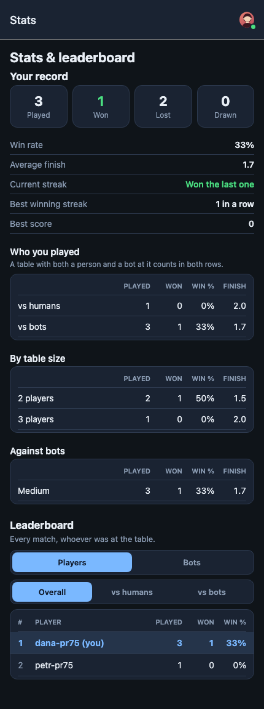

# FAQ and troubleshooting

## Getting in

### Do I need an account?

No. **Continue as guest** gets you playing straight away. You only need an
account for **Stats & leaderboard**, for **Record a live game**, and to have
a record kept of your results. See
[Guest or account?](getting-started.md#guest-or-account).

### I played as a guest and now my games are gone

Your guest identity is a key stored in this browser or app. You get a new
identity, and lose the old one, if:

- you cleared the browser's site data, used a private window, or switched
  browser;
- you reinstalled the app;
- you opened Jokerless on a different device.

To keep it, open **Account** while you're a guest and copy
**Your guest link** somewhere safe. Opening it on any device brings that
guest back (**Continue as this guest**). Without the link, a lost guest
identity can't be recovered. Signing in is the reliable fix: games you played
as a guest on this device can be added to your account with
**Keep these games**.

### "You are signed in to an account. Sign out first to use a guest link."

A guest link only works when you're not signed in. Sign out from the account
menu, then open the link again.

### I didn't get my email sign-in code

Check your spam folder, and make sure the address is right (**Use a
different address**). The code expires a few minutes after it's sent, so
request a new one with **Send code** if it's been a while.

### "Can't reach the server. Check your connection and try again."

The app can't contact jokerless.com. Check your internet connection. In the
iPhone, Android and Mac apps, **Play offline** still works with no internet.
See [Offline play](offline-and-mobile.md).

### I can't find Poker, Blackjack, Oko bere, Ferbl or Siete y Medio

These games are played for chips and are for players 18 and over. On iPhone
and Android the app asks the operating system for your age range, and hides
them from players under 18. Right after launch they may also take a few
seconds to appear while that answer arrives.

## At the table

### My connection dropped. Did I lose the game?

No. The game is kept on the server and you take your seat back when you
reconnect. Open the table again from **Resume** on the games list, or from
**My games**. Depending on the table's **When a player drops** setting, a bot
may have played for you meanwhile: "A bot played for you while you were
away. Your seat is yours again." A match where a bot played part of the game
for you doesn't count towards your record.

### Someone else dropped and we're stuck waiting

The host can press **Let a bot play now** on the banner, or send the player a
link back to their seat with **Invite back**. If the player isn't coming
back, the host can **Give this seat to someone else**. If the table was set
up with **Wait for them**, it waits until the host steps in.

### The table says "Opened in another tab — this one has stopped syncing"

The same seat is open in another tab or on another device. Press **Use this
tab** to play here.

### "Nobody came back to this table, so it was set aside"

Tables nobody is playing are put away. The cards are exactly where you left
them. Press **Pick up where you left off**.

### A button is greyed out. Why can't I do that?

Press the **why** link beside it. It gives the reason, the rule from the
game's written rules that applies, and what you can do instead. A card in
your hand with a mark has its own **Why is this card marked?** explanation.

### Can I take a move back?

Sometimes. Žolíky, Canasta and Solitaire offer undo for some moves; see
[Undo](playing.md#undo). Moves that reveal new information, such as turning a
card up, can't be undone.

### Is there an AI coach?

In the app, the coaching tools are:

- **Hint**: asks what a bot would play in your position and shows
  "Suggested: …". It only works at tables where **Hints** is allowed, and it
  never plays the move for you.
- **Learn to play**: a guided lesson for every game, with a coach card that
  walks you through a real table.
- The **why** sheet, which explains any refused move from the written rules.

The **AI** opponent strength (in Žolíky, Canasta and Poker) is a trained
model that you play against. It doesn't advise you. An AI assistant such as
Claude Code can also be seated at a table as a player with
**Connect an AI agent**. It plays its own seat and doesn't see yours.

### The bots seem to be playing badly all of a sudden

When the server is very busy, bots may play simpler moves until it has room.
Their seats show **SIMPLER** while this happens, and the table lobby warns:
"The server is busy right now, so bots may play simpler moves until it has
room."

### The rules in the app are different from the rules I know

Many of these games have regional variations. Jokerless offers the common
ones as variations and house rules (options) on the setup screen, and the
written rules (**Rules ›**) always describe the table you're at, with its
options. If a rule you play by isn't offered, the game can't be set to it
yet.

## Statistics

Account menu › **More** › **Stats & leaderboard** (signed-in players only).

- **Your record**: matches **Played**, **Won**, **Lost** and **Drawn**, plus
  **Win rate**, **Average finish** (1 is first; lower is better),
  **Current streak**, **Best winning streak** and **Best score**.
- **Who you played** (vs humans, vs bots; "A table with both a person and a
  bot at it counts in both rows"), **By game**, **By table size** and
  **Against bots** (by bot strength).
- **Leaderboard**: **Players** or **Bots**, counted **Overall**,
  **vs humans** or **vs bots**.

What doesn't count: lessons, games played as a guest (unless you later add
them to your account), matches in which a bot played part of the game for
you, matches in which somebody took over a seat partway through, and
anything in **Record a live game**.

## Privacy and your data

From the in-app Privacy Notice (**Settings › The small print**):

- Jokerless has "no analytics service, no advertising network, and no
  tracking pixels", and doesn't sell your data.
- It stores your display name and face, your sign-in details (an email
  address, or a link to Google or Apple; a hashed password for username
  accounts), your results and statistics, the moves of your games, your game
  circle, and the time zone your device reports. Your location isn't stored.
- Finished games, with no names or account identifiers in them, are used to
  train the computer opponents.
- Other players see your display name and face at a table and in the waiting
  room, and see your results on the leaderboard.
- Games played at a table hosted on a phone stay on that phone, unless the
  players agree to save them to their accounts.

You can ask for a copy of your data, a correction or a deletion by writing to
the contact address given in the Privacy Notice.

## Deleting your account

Signed-in players can do this themselves: account menu › **Account** ›
**Delete account**. The app asks you to confirm:

> This deletes your account on every device: how you sign in, your
> statistics, your game circle and your score tables. Games you played stay
> in the other players' history, without your name. This cannot be undone.

In games you've played, your seat is renamed "Player 1", "Player 2" and so
on. Guests have no account to delete. Clearing the app's data, or the
browser's site data, removes the guest key from the device.

## Which version am I running?

Account menu › **About** shows the app and server versions. Mention them if
you report a problem.
